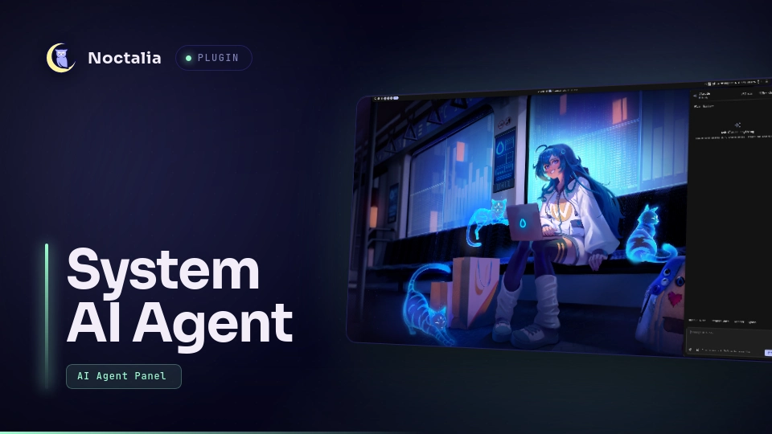

<!-- noctalia-pr-template:v1 -->

## Plugin

- **Id:** `notkirilov/system-ai-agent`
- [x] New plugin
- [ ] Update to an existing plugin (version bumped in `plugin.toml`)

## What it does

A chat panel for the Claude Code CLI that slides in from the right edge of the screen. It streams answers as
Markdown, shows tool calls and permission requests as cards, resumes local Claude Code chats, suggests slash commands
and `@` file paths (keyboard navigable), pastes screenshots, copies code blocks, and branches a chat from any answer.
A bar widget shows the agent state; a service keeps the bridge running and sends notifications.

## External dependencies

- `python3` (declared): the service starts one bridge, `python3 -I bridge/agentd.py`, standard library only. Luau
  cannot hold a long-lived child process with stdin/stdout streams, so the bridge owns it.
- `claude` (declared): the bridge starts one
  `claude -p --input-format stream-json --output-format stream-json --permission-prompt-tool stdio` process on the
  first message and stops it with the bridge.
- `wl-paste` (optional): run on Ctrl+V to read the clipboard image or text.
- `magick` (optional): run to shrink a pasted image larger than 3.75 MB.

Network: the panel talks to the bridge over HTTP on `127.0.0.1`, random port, random 256-bit bearer token kept in
memory; requests with an `Origin` header or a wrong `Host` are rejected. The plugin makes no other connections;
Claude Code talks to Anthropic as it always does.

Filesystem writes, all under the plugin data directory unless noted:

- `preferences.json` (0600): model, effort and access mode chosen in the panel.
- `last_session.json` (0600): id of the last conversation, for `--resume`.
- `images/` (0700, files 0600): pasted images, pruned after 7 days.
- `$XDG_RUNTIME_DIR/system-ai-agent/agentd.lock`: keeps a single bridge running.

Reads: Claude Code transcripts in `~/.claude/projects/` (or `$CLAUDE_CONFIG_DIR/projects`) for the chat picker and
history. The plugin never edits them.

## Testing

Opened the panel with `noctalia msg panel-toggle notkirilov/system-ai-agent:panel`, sent messages, answered
permission cards, switched chats, pasted screenshots, branched from an answer, navigated suggestions with the
keyboard, changed settings, and ran `noctalia msg plugin notkirilov/system-ai-agent:service all status`.

- [ ] Tested on Niri
- [x] Tested on Hyprland
- [ ] Tested on Sway
- [ ] Tested on another compositor:
- **Noctalia version tested against:** 5.4.1
- **Plugin API level:** 43

## Screenshots / Videos

<!-- TODO: add a screenshot of the bar widget and a short video of the panel -->

## Checklist

- [ ] The directory name matches the part of `id` after the `/` in `plugin.toml` exactly.
- [ ] It ships `plugin.toml`, `README.md`, `thumbnail.webp`, and `translations/en.json`.
- [ ] `README.md` follows the
      [README template](https://github.com/noctalia-dev/community-plugins/blob/main/README_TEMPLATE.md), documents
      every entry id and dependency, and includes exact panel IPC commands and launcher prefixes where applicable.
- [ ] `thumbnail.webp` is present and relevant; for a new plugin I created it with the [thumbnail generator](https://assets.noctalia.dev/plugins/thumbnail-generator.html), and for an update I regenerated it with the generator if the visual identity or user-facing appearance changed.
- [ ] `version` follows semver and is bumped in this PR; `plugin_api` is the oldest API level this plugin requires.
- [ ] Every non-English translation in this PR uses a locale supported by Noctalia core, and I can read, write, and
      understand that language well enough to review and maintain it (no unreviewed machine/LLM translations).
- [ ] I did not edit `catalog.toml`; CI generates it.
- [ ] This PR touches exactly one plugin directory.

## Code review attestation

- [ ] The code is readable and not obfuscated, minified, or generated.
- [ ] Code identifiers and code comments are in English.
- [ ] It does not download and execute remote code.
- [ ] Every network call, filesystem write, and spawned process is something the description above accounts for.
- [ ] I have the right to publish this code under the `license` declared in `plugin.toml`.
