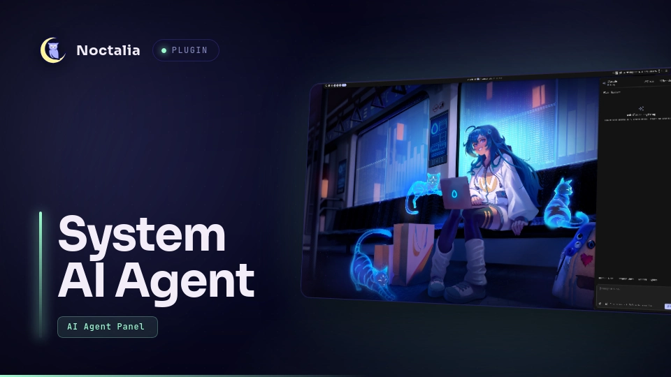

<!-- Русская копия описания PR, для себя. В сам PR вставляется английская версия: docs/community-pr.md -->

## Плагин

- **Id:** `notkirilov/system-ai-agent`
- [x] Новый плагин
- [ ] Обновление существующего плагина (версия в `plugin.toml` поднята)

## Что делает

Панель чата с Claude Code CLI, которая выезжает из правого края экрана. Ответы стримятся в Markdown, вызовы
инструментов и запросы разрешений показываются карточками. Плагин продолжает локальные чаты Claude Code, подсказывает
слэш-команды и пути к файлам через `@` (по подсказкам можно ходить с клавиатуры), вставляет скриншоты, копирует блоки
кода и делает ветку чата от любого ответа. Виджет на панели показывает состояние агента; сервис держит мост запущенным
и присылает уведомления.

## Внешние зависимости

- `python3` (объявлен): сервис запускает один мост, `python3 -I bridge/agentd.py`, только стандартная библиотека.
  Luau не умеет держать долгоживущий дочерний процесс с потоками stdin/stdout, поэтому этим занимается мост.
- `claude` (объявлен): мост запускает один процесс
  `claude -p --input-format stream-json --output-format stream-json --permission-prompt-tool stdio` при первом
  сообщении и останавливает его вместе с собой.
- `wl-paste` (необязательно): запускается по Ctrl+V, чтобы прочитать картинку или текст из буфера обмена.
- `magick` (необязательно): запускается, чтобы уменьшить вставленную картинку больше 3,75 МБ.

Сеть: панель общается с мостом по HTTP на `127.0.0.1`, порт случайный, bearer-токен случайный (256 бит) и хранится
только в памяти; запросы с заголовком `Origin` или чужим `Host` отклоняются. Других соединений плагин не открывает;
Claude Code ходит в Anthropic как обычно.

Запись на диск, всё в каталоге данных плагина, если не сказано иное:

- `preferences.json` (0600): модель, effort и режим доступа, выбранные в панели.
- `last_session.json` (0600): id последнего разговора, для `--resume`.
- `images/` (0700, файлы 0600): вставленные картинки, удаляются через 7 дней.
- `$XDG_RUNTIME_DIR/system-ai-agent/agentd.lock`: не даёт запустить второй мост.

Чтение: транскрипты Claude Code в `~/.claude/projects/` (или `$CLAUDE_CONFIG_DIR/projects`) для списка чатов и
истории. Плагин их никогда не меняет.

## Проверка

Открывал панель командой `noctalia msg panel-toggle notkirilov/system-ai-agent:panel`, отправлял сообщения, отвечал на
карточки разрешений, переключал чаты, вставлял скриншоты, делал ветку от ответа, ходил по подсказкам с клавиатуры,
менял настройки и запускал `noctalia msg plugin notkirilov/system-ai-agent:service all status`.

- [ ] Проверено на Niri
- [x] Проверено на Hyprland
- [ ] Проверено на Sway
- [ ] Проверено на другом композиторе:
- **Версия Noctalia:** 5.4.1
- **Уровень Plugin API:** 43

## Скриншоты / видео

<!-- TODO: добавить скриншот виджета на панели и короткое видео работы панели -->

## Чек-лист

- [ ] Имя каталога в точности совпадает с частью `id` после `/` в `plugin.toml`.
- [ ] В плагине есть `plugin.toml`, `README.md`, `thumbnail.webp` и `translations/en.json`.
- [ ] `README.md` сделан по [шаблону](https://github.com/noctalia-dev/community-plugins/blob/main/README_TEMPLATE.md),
      описывает каждый id точки входа и каждую зависимость, содержит точные IPC-команды панели и префиксы лаунчера,
      где они есть.
- [ ] `thumbnail.webp` есть и подходит плагину; для нового плагина я сделал его в
      [генераторе превью](https://assets.noctalia.dev/plugins/thumbnail-generator.html).
- [ ] `version` соответствует semver и поднята в этом PR; `plugin_api` — самый старый уровень API, который нужен плагину.
- [ ] Каждый не-английский перевод в PR использует локаль, которую поддерживает ядро Noctalia, и я владею этим языком
      достаточно, чтобы проверять и поддерживать перевод (без непроверенного машинного/LLM-перевода).
- [ ] Я не редактировал `catalog.toml`; его генерирует CI.
- [ ] PR затрагивает ровно один каталог плагина.

## Подтверждение ревью кода

- [ ] Код читаемый, не обфусцирован, не минифицирован и не сгенерирован.
- [ ] Идентификаторы и комментарии в коде на английском.
- [ ] Плагин не скачивает и не выполняет удалённый код.
- [ ] Каждый сетевой вызов, запись в файлы и запуск процесса учтены в описании выше.
- [ ] У меня есть право публиковать этот код под лицензией, указанной в `plugin.toml`.
